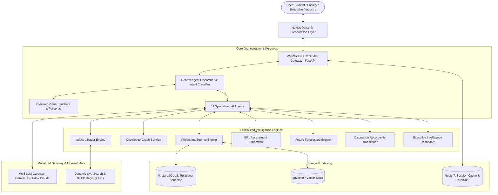
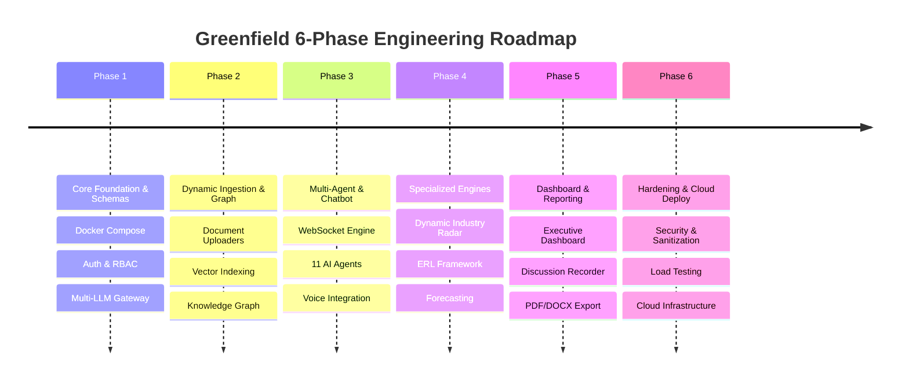
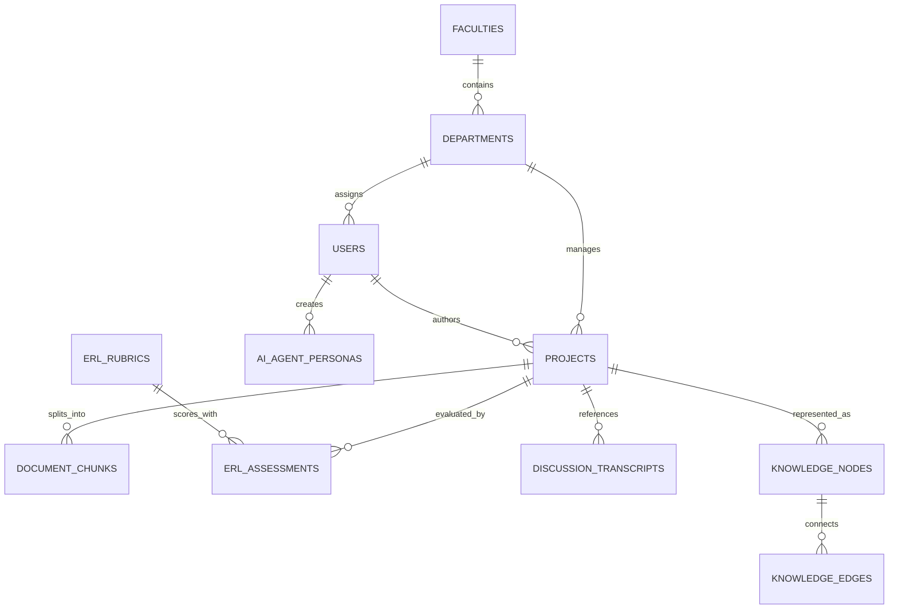

# SHU ORIC AI – Research, Innovation & Industry Intelligence Ecosystem
## Greenfield Technical Architecture & System Transformation Specification
**Salim Habib University (SHU), Karachi, Pakistan**  
*Document Version: 3.0-GREENFIELD | Status: Approved Architecture Baseline*  
*Role: Principal Software Engineer & Enterprise Solutions Architect*

---

## Executive Summary of the Greenfield Pivot
This document establishes the official architectural baseline and technical specification for transitioning the **SHU ORIC AI Ecosystem** into a **100% greenfield build (built from scratch)**. 

In strict adherence to the greenfield mandate:
1. **Zero Legacy Assumptions**: All dependencies on auditing, scraping, parsing, or maintaining backward compatibility with `oric-shu.vercel.app` or previous prototype scripts are permanently expunged.
2. **Dynamic Ingestion Over Hardcoding**: Hardcoded project listings, static faculty rosters, and fixed industrial zone dictionaries are replaced with a dynamic, multi-tenant relational and vector-indexed data pipeline.
3. **Enterprise Prompt & Persona Governance**: Static in-code bot prompts are replaced with a database-backed, version-controlled **Prompt & Persona Management Engine** supporting customizable Virtual Teachers and domain advisors.
4. **Configurable Readiness Rubrics**: Fixed Entrepreneurship Readiness Level (ERL) checklists are upgraded to dynamic, database-driven evaluation rubrics supporting variable weightings, custom milestone interventions, and institutional policy adaptations.

```
+--------------------------------------------------------------------------------------------------+
|                                    SHU ORIC AI GREENFIELD ECOSYSTEM                              |
+--------------------------------------------------------------------------------------------------+
|  [ Presentation Layer: Next.js 14 + Tailwind CSS + WebSockets + Web Speech API / WebRTC ]        |
+--------------------------------------------------------------------------------------------------+
|  [ API Gateway & Ingestion: FastAPI (Python 3.12+) + Multi-Format Document Parser (PDF/DOCX) ]    |
+--------------------------------------------------------------------------------------------------+
|  [ AI Orchestration: Central Intent Router + 11 Specialized AI Agents + Dynamic Personas ]       |
+--------------------------------------------------------------------------------------------------+
|  [ Multi-LLM Gateway: Unified Provider Abstraction (Google Gemini 1.5, OpenAI GPT-4o, Claude) ]  |
+--------------------------------------------------------------------------------------------------+
|  [ Data & Knowledge Layer: PostgreSQL 16 (Relational + pgvector) + Redis 7 + Knowledge Graph ]   |
+--------------------------------------------------------------------------------------------------+
```

---

## SECTION 1: GREENFIELD PROJECT OVERVIEW & ARCHITECTURE (SIMPLE TERMS)

### 1.1 System Vision
**SHU ORIC AI** is Salim Habib University's bespoke, enterprise-grade digital intelligence platform. It transforms the university's Office of Research, Innovation & Commercialization (ORIC) from a passive archival website into an active, proactive commercialization accelerator.

#### Why Built 100% From Scratch?
Legacy university platforms typically suffer from "digital graveyard syndrome": research projects are published as static HTML or flat PDFs that sit undiscovered by industry. Attempting to revamp or scrape existing frontends (like `oric-shu.vercel.app`) locks the university into fragile scraping selectors, lacks referential integrity, prevents real-time search across uncurated papers, and cannot support low-latency voice, streaming AI, or dynamic multi-agent reasoning.

A **100% greenfield build** provides:
- **Data Integrity**: Clean PostgreSQL relational schemas with foreign keys and strict referential validation.
- **Deep Semantic Discovery**: Direct, automated vectorization of research documents upon upload.
- **Zero-Latency Reactive UI**: Native WebSockets and streaming responses that eliminate polling.
- **Sovereign Persona Management**: University leadership can reconfigure Virtual Teachers and AI advisors directly from an admin console without touching backend code.

#### Connecting Research → Industry → Commercialization (In Plain Terms)
1. **Research (The Supply)**: Faculty, researchers, and students upload project proposals, theses, lab results, and patent filings into the system. The platform digests these documents, extracts technical claims, and assigns dynamic Technology Readiness Levels (TRL) and Entrepreneurship Readiness Levels (ERL).
2. **Industry (The Demand)**: The platform actively monitors commercial sectors—beginning with Karachi's major manufacturing hubs (Korangi, SITE, Landhi, Port Qasim, Federal B Area) and expanding nationwide and to the GCC. It maps corporate technology problems, supply chain gaps, and patent needs.
3. **Commercialization (The Matchmaker & Engine)**: Through an intelligent **Knowledge Graph** and **Opportunity Discovery Engine**, the system computes compatibility scores between university IP and industrial demands. It then automatically drafts investor briefings, licensing terms, collaborative MoUs, and commercialization roadmaps.

---

### 1.2 Core Modules Breakdown



The greenfield system consists of **eight foundational modules**:

#### 1. Core Chatbot & Virtual Teachers
A dual-mode conversational interface:
- **Conversational Mode**: Smooth, natural interaction suited for quick queries and general student mentoring.
- **Research Mode**: Rigorous, citation-backed analytical responses complete with literature references, methodology critique, and formal commercialization pathways.
- **Virtual Teachers Engine**: Dynamic, faculty-specific AI mentors (e.g., *Dr. Farooq – Pharmaceutical Formulation Specialist*, *Prof. Aisha – Biomedical Devices & Embedded Systems Mentor*, *Director ORIC – Commercialization & Patent Strategist*). They can be assigned custom system prompts, pedagogical styles, and domain knowledge filters.
- **Bilingual & Voice-Enabled**: Full support for English, Urdu, and bilingual Urdu-English code-switching using native Web Speech API and streaming WebSockets.

#### 2. Project Intelligence Engine (PIE)
The central intelligence repository for all SHU intellectual property. Automatically ingests, classifies, and indexes every research project, dissertation, and lab prototype across all university faculties (Pharmacy, Management Sciences, Information Technology, Computer Science, and Engineering). It enforces strict non-hallucination guardrails: if a project lacks commercial cost data or clinical trial results, it flags the missing fields instead of inventing them.

#### 3. The 11 Specialized AI Agents
Rather than relying on a single monolithic prompt, task routing is managed by 11 isolated, specialized agent workers:
1. **Project Intelligence Agent**: Answers queries about SHU projects, faculties, and cross-departmental capabilities.
2. **Scientific Research Agent**: Analyzes scientific principles, technological feasibility, and peer-reviewed literature.
3. **Web Research Agent**: Conducts live internet retrieval for current market events, international patents, and emerging tech.
4. **Business Strategy Agent**: Formulates Business Model Canvases, SWOT analyses, and PESTLE frameworks.
5. **Industry Intelligence Agent**: Maps corporate profiles, manufacturing supply chains, and industrial procurement needs.
6. **Financial Analysis Agent**: Calculates CAPEX/OPEX projections, investment requirements, and commercial pricing models.
7. **Forecasting Agent**: Models 1-year and 3-year market demand scenarios, technology disruption, and adoption curves.
8. **ERL Assessment Agent**: Evaluates projects across the multi-dimensional Entrepreneurship Readiness Level rubrics.
9. **Opportunity Discovery Agent**: Identifies serendipitous intersections between university research and external commercial demands.
10. **Executive Intelligence Agent**: Delivers high-level portfolio summaries, ROI rankings, and strategic recommendations for university leadership.
11. **Report Generation Agent**: Automatically compiles and formats publication-ready PDF, DOCX, and XLSX dossiers.

#### 4. The Knowledge Graph
An entity-relationship network mapping projects, faculties, technologies, patents, industrial equipment, corporate partners, and target industries. This allows the system to answer complex multi-hop queries such as: *"Which Computer Science machine learning models can be paired with Pharmacy research to create an automated diagnostic spin-off?"*

#### 5. Industry Intelligence Radar
A proactive monitoring module with real-time web search integration. Tracks Karachi industrial estates (Korangi, SITE, Landhi, Port Qasim, Federal B Area, KEPZ), national industrial sectors, and regional hubs in the GCC (UAE, Saudi Arabia, Qatar, Oman). It extracts verified company activities, decision-maker contacts, and corporate innovation initiatives.

#### 6. ERL Assessment Framework
A fully dynamic implementation of the Entrepreneurship Readiness Level methodology. Evaluates projects across 8 key dimensions: Learning & Research, Innovation, Team, Market, Technology, Business Model, Intellectual Property, and Funding Sustainability.

#### 7. Discussion Recorder & Transcriber
A browser-based audio recorder leveraging WebRTC and Web Speech API. Transcribes research meetings, ORIC consultations, and industry brainstorming sessions in real time with speaker attribution. Automatically generates structured summaries, decisions made, and assigned action items, and links them directly to corresponding project profiles.

#### 8. Executive Intelligence Dashboard
A dedicated command portal for the Vice Chancellor, Deans, and the ORIC Director. Visualizes the university's innovation pipeline, faculty-wise productivity, pending patent filings, commercialization velocity, and actionable recommendations on where to deploy internal seed funding.

---

### 1.3 Greenfield Tech Stack

| Layer | Selected Technology | Architectural Rationale & Greenfield Role |
| :--- | :--- | :--- |
| **Frontend Framework** | **Next.js 14+ (App Router)** | Modern React framework with Server Components for fast initial loads, robust SSR, API routes, and enterprise route isolation (Admin, Executive, Researcher). |
| **Styling & Components**| **Tailwind CSS + Lucide Icons** | Utility-first CSS for responsive, accessible, institutional UI adhering to SHU branding. Custom glassmorphism and data-dense dashboards. |
| **Interactive Graph UI**| **Cytoscape.js / React Flow** | GPU-accelerated canvas rendering for exploring multi-node Knowledge Graph relationships interactively. |
| **Voice & Audio** | **Web Speech API & WebRTC** | Zero-latency, browser-native speech recognition and speech synthesis. Low-latency bidirectional audio streaming for voice discussions. |
| **Backend API** | **FastAPI (Python 3.12+)** | Asynchronous, type-safe ASGI framework. Ultra-fast JSON serialization, automatic OpenAPI documentation, and native WebSocket support. |
| **Data Validation** | **Pydantic v2** | Strict schema validation and settings management across all agent inputs, database models, and LLM structured outputs. |
| **Relational Database** | **PostgreSQL 16+** | ACID-compliant relational data store for users, roles, project metadata, discussion transcripts, prompt versions, and audit logs. |
| **Vector Storage** | **pgvector (or Qdrant)** | Vector similarity search integrated directly into PostgreSQL, eliminating dual-database synchronization overhead. HNSW indexing for sub-10ms retrieval. |
| **Caching & Pub/Sub** | **Redis 7 (Alpine)** | Distributed caching for session states, token-bucket rate limiting, active WebSocket connection tracking, and Celery background task brokering. |
| **AI Gateway & LLMs** | **Multi-Provider Adapter** | Unified Python abstraction layer routing between: <br>• **Google Gemini 1.5 Pro / Flash**: Huge context window (1M+ tokens), fast reasoning.<br>• **OpenAI GPT-4o**: Complex structured JSON parsing, code generation.<br>• **Anthropic Claude 3.5 Sonnet**: In-depth analytical writing, formal policy reports. |
| **Document Parsing** | **PyMuPDF, python-docx, openpyxl** | Greenfield ingestion pipeline extracting clean text, tables, and metadata from uploaded university research papers without legacy dependencies. |
| **Report Generation** | **WeasyPrint & python-docx** | Programmatic rendering of executive PDFs with custom CSS print stylesheets, plus native editable Microsoft Word `.docx` documents. |

---

## SECTION 2: STATIC TO DYNAMIC ELEMENTS AUDIT (WHAT NEEDS CHANGING)

Every legacy assumption identified in earlier revisions has been audited and converted into an enterprise dynamic solution:

```
+----------------------------------------------------------------------------------------------------+
|                                    STATIC TO DYNAMIC TRANSFORMATION                                |
+-----------------------------------+----------------------------------------------------------------+
| LEGACY STATIC ELEMENT             | GREENFIELD DYNAMIC REPLACEMENT                                 |
+-----------------------------------+----------------------------------------------------------------+
| Static project arrays / scraping  | Dynamic PostgreSQL schemas + drag-and-drop document ingestion  |
| Fixed Karachi industrial lists    | Real-time search engine API (Tavily/SerpAPI) + dynamic DB      |
| Hardcoded in-code system prompts  | Database-driven Prompt & Persona Management Studio             |
| Rigid, hardcoded ERL checklists   | Configurable Rubric Canvas DB with customizable weightings     |
| Static role lists & access checks | Granular RBAC tables with dynamic permission scopes            |
+-----------------------------------+----------------------------------------------------------------+
```

### 2.1 Static Project & Faculty Data
- **The Problem**: Previous specs assumed parsing fixed JSON files (`backend/data/raw_projects.json`) or building scrapers targeting `https://oric-shu.vercel.app/`. If a faculty member leaves, a new patent is filed, or a student updates a milestone, code edits or scraper rebuilds were required. Scrapers also fail silently whenever HTML class names change.
- **The Greenfield Solution**:
  1. **Dynamic PostgreSQL Schema**: Entities for `faculties`, `departments`, `faculty_profiles`, and `research_projects` connected via relational foreign keys.
  2. **Multi-Format Ingestion Pipeline**: An asynchronous file uploader supporting `.pdf`, `.docx`, `.xlsx`, and scanned lab notes. PyMuPDF and python-docx extract text, structured tables, and author metadata.
  3. **Automated Vector Embedding**: An asynchronous background Celery worker automatically chunks ingested documents, generates dense 1536/3072-dimension embeddings, and stores them in `pgvector` alongside metadata tags.
  4. **Admin Project Management Console**: A dynamic web interface where faculty members can submit proposals, and ORIC administrators can review, approve, edit, tag, or archive projects in real time.

### 2.2 Static Industrial & Geographic Radar
- **The Problem**: Legacy specifications hardcoded static arrays of Karachi industrial clusters (Korangi, SITE, Landhi) and an arbitrary list of local pharmaceutical or textile companies. This data becomes obsolete within months, fails to reflect corporate mergers, leadership changes, or new industrial parks (e.g., Dhabeji Special Economic Zone), and cannot adapt to international outreach (Saudi Arabia, UAE).
- **The Greenfield Solution**:
  1. **Dynamic External Search Pipeline**: Integrates live web search APIs (such as Tavily Search API, Google Custom Search, and SerpAPI) coupled with SECP (Securities and Exchange Commission of Pakistan) and PSX company registers.
  2. **Dynamic Company Knowledge Store**: A dedicated PostgreSQL table `industry_partners` that stores discovered enterprise leads, verified contact details, business sectors, technology requirements, and historical interactions with SHU.
  3. **Automated Sector Enrichment Engine**: When an ORIC officer selects an industrial cluster or sector (e.g., *"Medical Device Manufacturers in S.I.T.E."*), the Industry Intelligence Agent dynamically scans live company websites, extracts verified capabilities, and matches them to active SHU research.

### 2.3 Virtual Teachers & Chatbot Personas
- **The Problem**: In typical prototypes, bot personalities and system prompts are hardcoded as static strings inside Python files (`orchestrator.py`). Changing a virtual teacher's pedagogical style, adjusting tone, modifying language code-switching guidelines, or updating domain rules required a developer to edit code and redeploy the backend.
- **The Greenfield Solution**:
  1. **Database-Driven Persona Management**: A `ai_agent_personas` database table that stores persona parameters: `name`, `slug`, `faculty_id`, `system_prompt`, `temperature`, `model_provider`, `voice_profile_id`, and `knowledge_filter_tags`.
  2. **Admin Persona Studio**: ORIC administrators and Deans can create and modify Virtual Teachers on the fly through an intuitive UI. They can test prompt variants, configure domain bounds (e.g., preventing a Pharmacy mentor from giving unvalidated clinical dosage advice), and toggle personas on/off.
  3. **Version-Controlled Prompt History**: Every edit to a system prompt is archived in a `prompt_versions` table with timestamp and author metadata, enabling instant rollback if agent response quality degrades.

### 2.4 ERL & Assessment Scoring
- **The Problem**: Hardcoded assessment formulas or fixed scoring scripts for the Entrepreneurship Readiness Level. If the Higher Education Commission (HEC) of Pakistan updates ORIC commercialization guidelines or university leadership revises milestone weights, the scoring engine breaks or delivers non-compliant results.
- **The Greenfield Solution**:
  1. **Configurable Evaluation Canvas Schema**: Rubrics are stored as structured JSON records in a `erl_rubrics` table. Each rubric defines dimensions, assessment criteria, question prompts, scoring scales (0 to 9), and relative weightings.
  2. **Dynamic Evaluation Engine**: The ERL Assessment Agent loads the active rubric version at runtime, assesses project documentation against the criteria, calculates weighted scores, and outputs qualitative justifications.
  3. **Actionable Milestone Tracker**: Instead of a static number, the system creates dynamic database records for identified gaps and recommended interventions. Researchers can check off milestones as they achieve lab verification, patent filing, or customer discovery interviews.

---

## SECTION 3: REVISED GREENFIELD IMPLEMENTATION ROADMAP

The legacy audit-centric phases (Phase 0 website audit, scraping) are completely replaced with an enterprise 0-to-1 greenfield engineering roadmap:



### Phase 1: Core Foundation & Database Schema Design (Weeks 1 - 2)
- Initialize Git repository structure (`/frontend`, `/backend`, `/docker`, `/docs`).
- Establish Docker Compose environment for local development: PostgreSQL 16 with `pgvector`, Redis 7, and FastAPI.
- Execute Alembic migrations for initial relational models: Users, Roles, Faculties, Departments, Projects, and Audit Logs.
- Implement JWT authentication with role-based access control (Super Admin, ORIC Admin, Faculty, Researcher, Student, Guest).
- Build the Multi-LLM Gateway abstraction supporting Google Gemini, OpenAI, and Anthropic with automatic fallback handling.

### Phase 2: Dynamic Content Ingestion & Knowledge Graph (Weeks 3 - 4)
- Develop dynamic document upload endpoints (`POST /api/v1/projects/upload`) supporting PDF, DOCX, and XLSX files.
- Build chunking and embedding pipelines storing 1536/3072-dimensional vectors in `pgvector` with HNSW indexing.
- Construct the Knowledge Graph relational schema (`knowledge_nodes`, `knowledge_edges`) and automated entity-relationship extraction pipeline.
- Implement the Administrative CRUD dashboard for faculties, departments, and research projects.

### Phase 3: Multi-Agent Orchestrator & Conversational AI (Weeks 5 - 6)
- Develop the Central Agent Dispatcher in FastAPI with asynchronous query intent classification.
- Implement the 11 specialized AI agent workers with shared scratchpad context.
- Build the WebSocket streaming infrastructure for real-time token delivery to the frontend.
- Integrate the Web Speech API and WebRTC voice interface supporting English, Urdu, and bilingual code-switching.
- Deliver the Dynamic Persona Management Engine allowing runtime configuration of Virtual Teachers.

### Phase 4: Specialized Intelligence Engines (Weeks 7 - 8)
- Engineer the Industry Intelligence Radar with dynamic Tavily/Google Search integration for Karachi and national clusters.
- Build the Opportunity Discovery Engine executing cross-faculty bipartite graph matching between internal IP and external market gaps.
- Implement the dynamic ERL Assessment Canvas with configurable rubrics, automated gap identification, and radar visualization.
- Develop the Future Forecasting Engine delivering 1-year and 3-year market and technology trajectory projections.

### Phase 5: Executive Dashboard, Discussion Recorder & Reporting (Weeks 9 - 10)
- Construct the Discussion Recorder module: audio capture, real-time transcription, automated summarization, and action item extraction.
- Build the Executive Intelligence Dashboard with portfolio distribution charts, IP pipeline tracking, and strategic leadership querying.
- Develop the Report Generation Engine using WeasyPrint (PDF) and python-docx (DOCX) for formal project dossiers and investor decks.

### Phase 6: System Testing, Security Hardening & Cloud Deployment (Weeks 11 - 12)
- Comprehensive test coverage: Pytest unit tests, FastAPI integration tests, and Playwright end-to-end tests.
- Security hardening: Input sanitization, prompt injection defenses, file upload virus scanning, and Redis token-bucket rate limiting.
- Containerize application for cloud deployment (Docker, Vercel for Next.js frontend, managed cloud VM/K8s for FastAPI backend and PostgreSQL).

---

## SECTION 4: SYSTEM REQUIREMENTS & DATA SCHEMAS

### 4.1 Data Models (Clean Entity Schemas)

The database is built on **PostgreSQL 16** with the **`pgvector`** extension enabled. Below are the definitive entity models:



#### 1. `users` & `roles`
```sql
CREATE TABLE roles (
    id SERIAL PRIMARY KEY,
    name VARCHAR(50) UNIQUE NOT NULL, -- 'super_admin', 'oric_admin', 'faculty', 'researcher', 'student'
    permissions JSONB NOT NULL DEFAULT '[]'
);

CREATE TABLE users (
    id UUID PRIMARY KEY DEFAULT gen_random_uuid(),
    email VARCHAR(255) UNIQUE NOT NULL,
    hashed_password VARCHAR(255) NOT NULL,
    full_name VARCHAR(255) NOT NULL,
    role_id INT REFERENCES roles(id),
    department_id INT REFERENCES departments(id),
    is_active BOOLEAN DEFAULT TRUE,
    created_at TIMESTAMP WITH TIME ZONE DEFAULT NOW(),
    updated_at TIMESTAMP WITH TIME ZONE DEFAULT NOW()
);
```

#### 2. `faculties` & `departments`
```sql
CREATE TABLE faculties (
    id SERIAL PRIMARY KEY,
    name VARCHAR(255) UNIQUE NOT NULL, -- e.g., 'Faculty of Pharmacy', 'Faculty of Management Sciences'
    code VARCHAR(20) UNIQUE NOT NULL,   -- 'FOP', 'FMS', 'FCS', 'FE'
    dean_name VARCHAR(255),
    created_at TIMESTAMP WITH TIME ZONE DEFAULT NOW()
);

CREATE TABLE departments (
    id SERIAL PRIMARY KEY,
    faculty_id INT REFERENCES faculties(id) ON DELETE CASCADE,
    name VARCHAR(255) NOT NULL,
    code VARCHAR(20) NOT NULL,
    head_of_department VARCHAR(255)
);
```

#### 3. `projects` (Dynamic Project Intelligence Repository)
```sql
CREATE TABLE projects (
    id UUID PRIMARY KEY DEFAULT gen_random_uuid(),
    project_code VARCHAR(50) UNIQUE NOT NULL, -- e.g., 'SHU-FOP-2026-001'
    title VARCHAR(500) NOT NULL,
    department_id INT REFERENCES departments(id),
    principal_investigator_id UUID REFERENCES users(id),
    co_investigators JSONB DEFAULT '[]',
    abstract TEXT NOT NULL,
    problem_statement TEXT,
    technology_stack JSONB DEFAULT '[]',
    scientific_principles TEXT,
    innovation_novelty TEXT,
    development_stage VARCHAR(100), -- 'Concept', 'Lab Prototype', 'Bench Validated', 'Field Tested'
    trl_level INT CHECK (trl_level BETWEEN 1 AND 9),
    erl_level INT CHECK (erl_level BETWEEN 1 AND 9),
    ip_status VARCHAR(100),         -- 'None', 'Disclosure Filed', 'Patent Pending', 'Patent Granted'
    target_industries JSONB DEFAULT '[]',
    estimated_funding_pkr NUMERIC(15, 2),
    status VARCHAR(50) DEFAULT 'active', -- 'draft', 'submitted', 'verified', 'archived'
    created_at TIMESTAMP WITH TIME ZONE DEFAULT NOW(),
    updated_at TIMESTAMP WITH TIME ZONE DEFAULT NOW()
);
```

#### 4. `document_chunks` (pgvector Semantic Storage)
```sql
CREATE EXTENSION IF NOT EXISTS vector;

CREATE TABLE document_chunks (
    id UUID PRIMARY KEY DEFAULT gen_random_uuid(),
    project_id UUID REFERENCES projects(id) ON DELETE CASCADE,
    document_title VARCHAR(255) NOT NULL,
    chunk_index INT NOT NULL,
    chunk_text TEXT NOT NULL,
    token_count INT NOT NULL,
    embedding vector(1536), -- Dimension matches OpenAI text-embedding-3-small or Gemini text-embedding-004
    metadata JSONB DEFAULT '{}',
    created_at TIMESTAMP WITH TIME ZONE DEFAULT NOW()
);

CREATE INDEX idx_document_chunks_embedding ON document_chunks USING hnsw (embedding vector_cosine_ops);
```

#### 5. `ai_agent_personas` (Dynamic Virtual Teachers & Advisors)
```sql
CREATE TABLE ai_agent_personas (
    id UUID PRIMARY KEY DEFAULT gen_random_uuid(),
    slug VARCHAR(100) UNIQUE NOT NULL, -- 'pharmacy_virtual_teacher', 'medtech_advisor'
    display_name VARCHAR(255) NOT NULL,
    faculty_id INT REFERENCES faculties(id),
    role_type VARCHAR(100) NOT NULL,   -- 'virtual_teacher', 'oric_consultant', 'patent_examiner'
    avatar_url VARCHAR(500),
    system_prompt TEXT NOT NULL,
    temperature NUMERIC(3, 2) DEFAULT 0.40,
    preferred_model VARCHAR(100) DEFAULT 'gemini-1.5-flash',
    knowledge_filter_tags JSONB DEFAULT '[]',
    is_active BOOLEAN DEFAULT TRUE,
    created_at TIMESTAMP WITH TIME ZONE DEFAULT NOW(),
    updated_at TIMESTAMP WITH TIME ZONE DEFAULT NOW()
);
```

#### 6. `knowledge_nodes` & `knowledge_edges` (Polyglot Graph)
```sql
CREATE TABLE knowledge_nodes (
    id UUID PRIMARY KEY DEFAULT gen_random_uuid(),
    node_type VARCHAR(50) NOT NULL, -- 'Project', 'Technology', 'Faculty', 'Company', 'IndustrySector'
    entity_id VARCHAR(255) NOT NULL,
    label VARCHAR(255) NOT NULL,
    properties JSONB DEFAULT '{}',
    created_at TIMESTAMP WITH TIME ZONE DEFAULT NOW()
);

CREATE TABLE knowledge_edges (
    id UUID PRIMARY KEY DEFAULT gen_random_uuid(),
    source_node_id UUID REFERENCES knowledge_nodes(id) ON DELETE CASCADE,
    target_node_id UUID REFERENCES knowledge_nodes(id) ON DELETE CASCADE,
    relationship_type VARCHAR(100) NOT NULL, -- 'USES_TECH', 'COLLABORATES_WITH', 'APPLICABLE_TO'
    weight NUMERIC(4, 3) DEFAULT 1.000,
    properties JSONB DEFAULT '{}',
    created_at TIMESTAMP WITH TIME ZONE DEFAULT NOW()
);
```

#### 7. `erl_rubrics` & `erl_assessments` (Configurable Assessment Engine)
```sql
CREATE TABLE erl_rubrics (
    id SERIAL PRIMARY KEY,
    version_label VARCHAR(50) NOT NULL,
    is_active BOOLEAN DEFAULT TRUE,
    dimensions_config JSONB NOT NULL, -- 8 dimensions, criteria weights, and scoring anchors
    created_at TIMESTAMP WITH TIME ZONE DEFAULT NOW()
);

CREATE TABLE erl_assessments (
    id UUID PRIMARY KEY DEFAULT gen_random_uuid(),
    project_id UUID REFERENCES projects(id) ON DELETE CASCADE,
    rubric_id INT REFERENCES erl_rubrics(id),
    assessor_id UUID REFERENCES users(id),
    overall_erl_score INT CHECK (overall_erl_score BETWEEN 1 AND 9),
    dimension_breakdown JSONB NOT NULL,
    identified_gaps JSONB NOT NULL,
    recommended_interventions JSONB NOT NULL,
    next_milestones JSONB NOT NULL,
    assessed_at TIMESTAMP WITH TIME ZONE DEFAULT NOW()
);
```

#### 8. `discussion_transcripts` (Audio, Transcripts & Action Items)
```sql
CREATE TABLE discussion_transcripts (
    id UUID PRIMARY KEY DEFAULT gen_random_uuid(),
    title VARCHAR(500) NOT NULL,
    project_id UUID REFERENCES projects(id) ON DELETE SET NULL,
    recorded_by_id UUID REFERENCES users(id),
    duration_seconds INT DEFAULT 0,
    audio_file_path VARCHAR(1000),
    consent_obtained BOOLEAN DEFAULT TRUE,
    full_transcript TEXT NOT NULL,
    ai_summary TEXT,
    key_findings JSONB DEFAULT '[]',
    decisions_made JSONB DEFAULT '[]',
    action_items JSONB DEFAULT '[]',
    created_at TIMESTAMP WITH TIME ZONE DEFAULT NOW()
);
```

---

### 4.2 Core API Specifications

The backend exposes a modern, versioned REST and WebSocket API (`/api/v1`):

#### 1. Authentication & User Management
- `POST /api/v1/auth/login` → Authenticates credentials, returns JWT access and refresh tokens.
- `POST /api/v1/auth/refresh` → Rotates access token.
- `GET /api/v1/auth/me` → Returns authenticated user profile, permissions, and department.
- `GET /api/v1/admin/users` → Paginated list of university users (Admin only).

#### 2. Dynamic Projects & Document Ingestion
- `GET /api/v1/projects` → Paginated list of research projects with faculty, stage, and TRL filters.
- `POST /api/v1/projects` → Creates a new structured project profile.
- `GET /api/v1/projects/{project_id}` → Full detailed project dossier with vector-indexed metadata.
- `PUT /api/v1/projects/{project_id}` → Updates existing project details.
- `POST /api/v1/projects/{project_id}/documents` → Uploads PDF/DOCX research document, extracts text, generates vector embeddings in `pgvector`.
- `POST /api/v1/projects/bulk-import` → Ingests research datasets via Excel (`.xlsx`) or JSON.

#### 3. Conversational AI & WebSockets
- `WS /api/v1/ws/chat` → Stateful bidirectional WebSocket connection:
  - **Inbound Message**: `{ "session_id": "uuid", "message": "string", "mode": "conversational|research", "persona_slug": "pharmacy_mentor", "project_context_id": "uuid" }`
  - **Outbound Stream**: Streams token chunks `{ "token": "string" }`, agent status updates `{ "agent": "Scientific Research Agent", "status": "searching" }`, and final citations.
- `GET /api/v1/personas` → Returns active Virtual Teachers and ORIC advisors.
- `POST /api/v1/personas` → Creates or reconfigures a dynamic Virtual Teacher persona (Admin only).

#### 4. Specialized Intelligence Engines
- `GET /api/v1/intelligence/graph` → Retrieves Knowledge Graph nodes and edges for Cytoscape.js rendering.
- `POST /api/v1/intelligence/industry-radar` → Runs targeted live search for companies in specified industrial zones (e.g., Korangi, Landhi) matching an SHU technology.
- `POST /api/v1/intelligence/opportunity-match` → Computes automated compatibility scores between all active SHU projects and live industry opportunities.
- `POST /api/v1/intelligence/forecast/{project_id}` → Generates 1-year and 3-year market and technology forecast scenarios.

#### 5. ERL Assessment Engine
- `GET /api/v1/erl/rubrics/active` → Returns current 8-dimension rubric configuration.
- `POST /api/v1/erl/assess/{project_id}` → Triggers automated ERL evaluation across all dimensions.
- `GET /api/v1/erl/history/{project_id}` → Retrieves past assessment trajectories and milestone completion history.

#### 6. Discussion Management
- `POST /api/v1/discussions/upload-audio` → Uploads recorded meeting audio file.
- `POST /api/v1/discussions/transcribe` → Processes speech-to-text, diarizes speakers, and generates summary/action items.
- `GET /api/v1/discussions/{discussion_id}/export/{format}` → Exports transcript and summary as PDF, DOCX, or TXT.

#### 7. Executive Dashboard & Reporting
- `GET /api/v1/executive/overview` → Aggregated metrics: total projects, faculty distribution, TRL/ERL distribution, pending patents.
- `POST /api/v1/reports/generate` → Compiles and streams a formatted PDF/DOCX dossier (Project Assessment, Feasibility, Portfolio Review).

---

## SECTION 5: ACTION ITEM SUMMARY

### Sprint Zero Engineering Checklist (Immediate Execution)

- [ ] **Infrastructure & Environment Setup**:
  - [ ] Initialize Git monorepo structure: `/frontend`, `/backend`, `/docker`, `/docs`.
  - [ ] Author `docker-compose.yml` defining PostgreSQL 16 (`pgvector/pgvector:pg16`), Redis 7 Alpine, and backend application container.
  - [ ] Configure environment variables template (`.env.example`) with multi-provider API keys (`GEMINI_API_KEY`, `OPENAI_API_KEY`, `ANTHROPIC_API_KEY`, `TAVILY_API_KEY`).

- [ ] **Backend Baseline (FastAPI & SQLAlchemy)**:
  - [ ] Configure FastAPI application skeleton with Pydantic v2 settings management.
  - [ ] Configure async SQLAlchemy 2.0 engine and initialize Alembic migrations.
  - [ ] Implement initial migration script for `roles`, `users`, `faculties`, `departments`, `projects`, and `document_chunks`.
  - [ ] Build the Multi-LLM Gateway abstraction class with streaming token generators and automatic fallback.

- [ ] **Dynamic Document Ingestion Sandbox**:
  - [ ] Implement PyMuPDF and python-docx text extraction utilities.
  - [ ] Implement semantic text chunker with configurable token window and overlap.
  - [ ] Write integration test validating end-to-end vector embedding generation and cosine distance querying in `pgvector`.

- [ ] **Frontend Foundation (Next.js & Tailwind CSS)**:
  - [ ] Scaffold Next.js 14+ application using App Router and TypeScript.
  - [ ] Configure Tailwind CSS design system adhering to Salim Habib University brand colors (Navy Blue `#0A2540`, Gold `#C59B27`, Slate Gray `#F4F6F9`).
  - [ ] Implement layout shell: Left Navigation Bar, Central Chat/Workbench Workspace, and Right Context Panel.
  - [ ] Build reusable WebSocket hook with auto-reconnect and token streaming state management.

- [ ] **Governance & Verification**:
  - [ ] Document project conventions in `/docs/DEVELOPMENT_GUIDE.md`.
  - [ ] Ensure all codebases are clean of any legacy web scrapers or hardcoded project lists.

